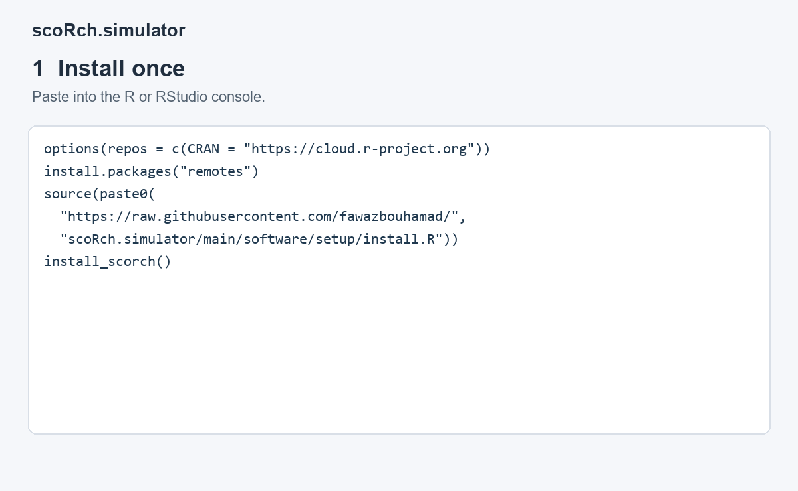
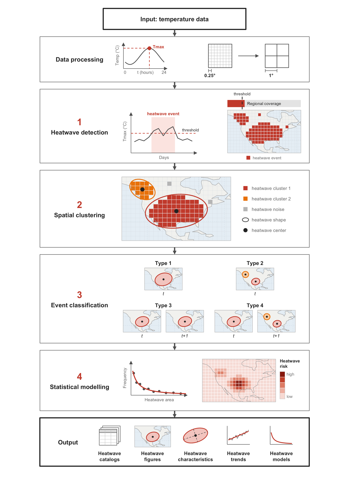
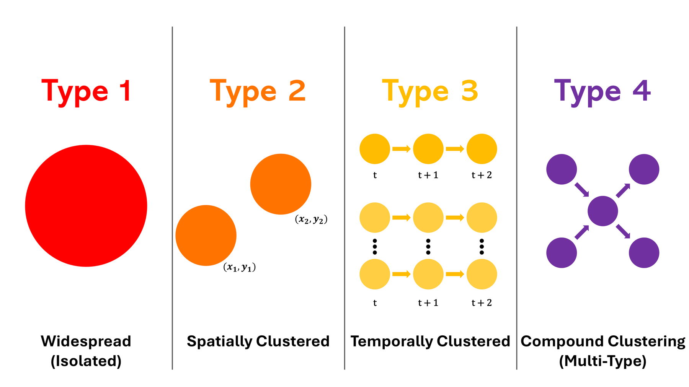

# scoRch.simulator

**Supply temperature data. Run once. Get every catalog, model, table and figure.**

An R implementation of SCORCH: Spatiotemporal Classification of Regional Compound Heatwaves, developed by Fawaz Bouhamad and Nasser Najibi. The software identifies and characterizes heatwaves in supplied temperature data.

**[config.yaml](config.yaml) is the only file you edit.** A complete example is included, so the first run needs no data download or configuration changes.

## Install once

You need **R 4.1 or newer**. Open R or RStudio and paste:

```r
options(repos = c(CRAN = "https://cloud.r-project.org"))
install.packages("remotes")
source("https://raw.githubusercontent.com/fawazbouhamad/scoRch.simulator/main/software/setup/install.R")
install_scorch()
```

## Run the software

```r
scoRch.simulator::run_scorch()
```

The software reads `config.yaml` in your working folder, creating a copy automatically if absent. It processes the input and runs the entire analysis. You never need to run the numbered scripts individually.



The supplied settings run the US example: April–September 1996–2025, 1,800 one-degree cells and 5,490 dates in about 12 MB. The domain includes adjacent waters. A reference run took 31 seconds; time varies by computer. The analysis uses 5,000 bootstrap repetitions and fixed seeds.

## Open your results

R prints the full results-folder path. **Open `Run_Summary.txt` first:** it explains the settings, results and warnings, and traces one event through the analysis. Results go to `output/` inside your working folder; `getwd()` in R shows that folder.

| Supplied example result | Contents |
|---|---|
| [Run summary](demo/output/Run_Summary.txt) | Counts, settings, files, warnings and a traced event |
| [Heatwave statistics](demo/output/Heatwave_Statistics.xlsx) | Event-type summary, cell thresholds, daily extent and duration trends |
| [Catalogs 1–5](demo/output/catalogs/) | Local heatwaves → regional days → clusters → ellipses → compound events |
| [Models](demo/output/modeling/) | Power-law fits and the spatial model of ellipse centroids |
| [Figures](demo/output/figures/) | Nine maps and statistical plots |

Reruns replace package-generated files in the chosen output folder. Change `output: directory` to keep separate runs. Empty spreadsheet cells mean missing values. The summary identifies incomplete runs, unavailable models and skipped figures. The spatial model describes centroid occurrence intensity; exposure and vulnerability are not modeled, and concentration rank is not a heatwave probability.

## Change only the configuration

Open `config.yaml`, edit the settings you need, save it and run **the same command** again. Keep the indentation. Quote paths and use forward slashes, for example `"C:/data/temperature.nc"`. Relative paths use R's working folder.

| Setting | What it controls |
|---|---|
| `input: file` | `null` runs the bundled example; otherwise enter your file or ERA5 folder |
| `input: format` | `daily_tmax` for prepared daily maxima; `era5` for local ERA5 temperature |
| `output: directory` | Destination for all results |
| `period` | Months and dates to analyze |
| Other sections | Heatwave thresholds, clustering, ellipses, models and figure choices |

For your own data, replace the matching sections with your paths and period:

```yaml
input:
  file: "C:/data/my_era5_folder"
  format: era5
  processed_file: "C:/data/prepared_tmax.nc"
output:
  directory: "output/my_analysis"
period:
  warm_season_months: [4, 5, 6, 7, 8, 9]
  start_date: "1996-04-01"
  end_date: "2025-09-30"
```

The software converts hourly temperature to UTC daily maxima, averages complete blocks into one-degree cells, saves prepared input when requested, and runs every analysis stage. Obtain local NetCDF files for your chosen region first; no API key is used by the software. Hourly files need complete UTC days on the same regular grid without overlapping dates. Prepared input needs a complete record in every retained cell. `?read_era5` and `?read_tmax` explain the accepted formats.

Review the study defaults when changing region, season or period. Local thresholds use all analyzed dates; temperature-weighted centroids require positive Celsius Tmax in every cluster cell. The `demo` section supplies example-only figure choices and the optional hourly preset. Your own input uses the main settings above it. A different configuration can be passed to `run_scorch("C:/analysis/config.yaml")`.

## Understand the workflow

Temperature → local heatwaves → regionally extensive days → spatial clusters → ellipses → compound events → models, tables and figures.



Local heatwaves belong to individual grid cells. Consecutive regionally extensive days form compound events, classified by their daily cluster counts:

| Type | Pattern |
|---|---|
| 1 | One day with one cluster |
| 2 | One day with several clusters |
| 3 | Several days, each with one cluster, or each with several clusters |
| 4 | Several days mixing those patterns, or including a day without a cluster |



The original study covers the Eastern Mediterranean and Middle East, 1940–2025. The bundled US example applies the same method to another input. The [research reproduction](https://github.com/fawazbouhamad/compound-heatwave-typologies-SCORCH) and [study dataset](https://doi.org/10.5281/zenodo.21717874) are separate records.

## Repository guide

| Location | Purpose |
|---|---|
| [config.yaml](config.yaml) | Your editable settings |
| [software/scripts/](software/scripts/) | Numbered analysis modules |
| [software/help/](software/help/) | R help pages; `.Rd` means R documentation |
| [software/figures/](software/figures/) | Workflow, event types and demonstration |
| [software/setup/](software/setup/) | Installation, package metadata and maintenance |
| [software/tests/](software/tests/) | Automated checks; `testthat` is the library, fixtures are reference data |
| [demo/](demo/) | Example input, saved results, attribution and optional launcher |

<details>
<summary>Developer setup and verification</summary>

The installer maps `scripts/` to R's `R/`, `help/` to `man/`, and setup metadata to the package root. `DESCRIPTION` lists package information and dependencies; `NAMESPACE` lists exported functions. Fixture-local `.gitattributes` preserves CSV line endings.

To install a downloaded repository, source `software/setup/install.R` and call `install_scorch(path = ".")`. From the repository root, `Rscript demo/run.R` runs the same workflow; `Rscript software/setup/maintenance.R compare` checks it against `demo/output/`. Use `--help` for validation and rebuild commands. Assemble with `Rscript software/setup/install.R .package`, then check with `devtools::check(".package")`.

[GitHub Actions](https://github.com/fawazbouhamad/scoRch.simulator/actions) checks Windows, macOS and Linux and compares the demonstration. The reference has 65,790 local heatwaves, 140 selected days, 376 ellipses and 29 compound events. All 16 worksheets are compared at portable tolerances of 1e-6, or 1e-3 for LGCP fits. Optional full-study tests require the separate reference input. The matching 30-year hourly archive is still being acquired and validated for a separate deposit. The bundled compact input is rounded to 0.01°C; exact hourly/prepared comparisons use float64 input saved from those same hourly files.

The authors developed the method and study implementation. Claude Code and Codex assisted with packaging, documentation, input interfaces, figure alignment and validation. The authors retain responsibility for the software and manuscript.

</details>

## Citation and support

Use [CITATION.cff](CITATION.cff) or `citation("scoRch.simulator")`. Code is [GPL-3.0-or-later](LICENSE.txt); [data provenance](demo/PROVENANCE.txt) accompanies the example. Version 1.0.1 is in development. The historical `scoRch.generator` release has different commands and folders; follow this page for the current software.

If installation fails, read the first dependency error. Input errors identify the affected file or setting. For help, open an [issue](https://github.com/fawazbouhamad/scoRch.simulator/issues) with the error, R/package versions and configuration.
