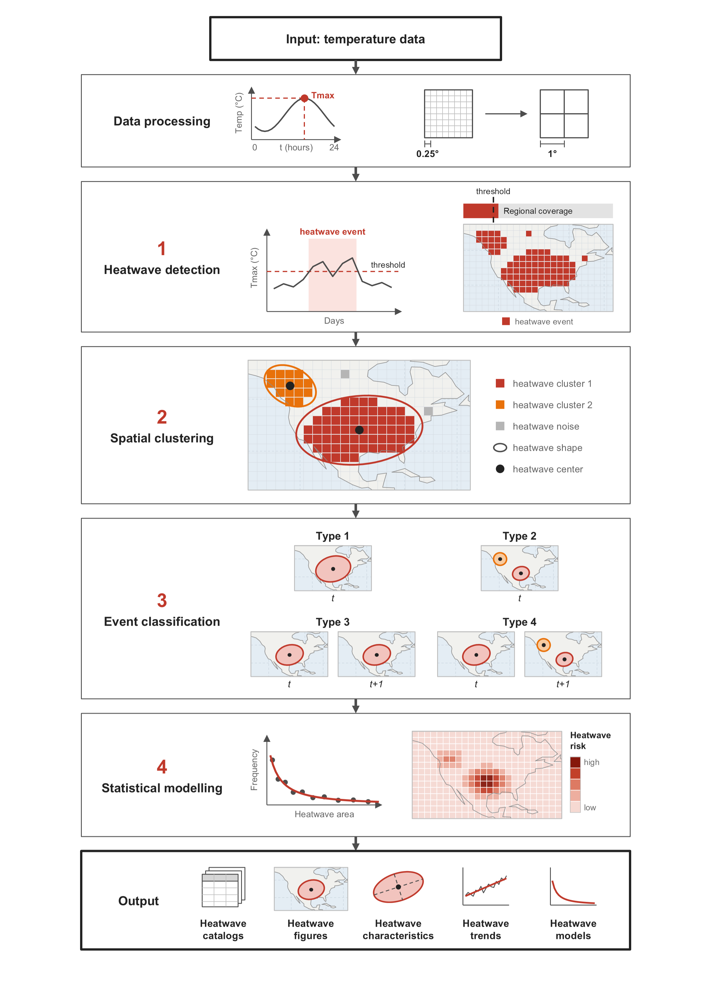

# scoRch.simulator

[](LICENSE.txt)
[](software/setup/DESCRIPTION)
[](https://github.com/fawazbouhamad/scoRch.simulator/releases/tag/v1.0.3)
[](https://github.com/fawazbouhamad/scoRch.simulator/actions/workflows/checks.yaml)

An R package implementing **SCORCH: Spatiotemporal Classification of Regional
Compound Heatwaves**, developed by **Fawaz Bouhamad and Nasser Najibi**.

The package applies the SCORCH framework to local ERA5 or prepared daily maximum
temperature data, producing heatwave catalogs, statistical models, tables and
figures. A complete North America example is included.



## Installation

You need **R 4.1 or newer**. In R or RStudio, run:

```r
options(repos = c(CRAN = "https://cloud.r-project.org"))
install.packages("remotes")
source("https://raw.githubusercontent.com/fawazbouhamad/scoRch.simulator/v1.0.3/software/setup/install.R")
install_scorch()
```

To update, restart R and run the same installation block.

## Running the software

Open a new RStudio project and run the included example:

```r
scoRch.simulator::run_scorch()
```

The software creates [config.yaml](config.yaml) in your project folder and runs
the full analysis. No separate data download is needed.

For **your own data**:

1. Open the example's config.yaml, or create one in a new project with
   `scoRch.simulator::write_scorch_config()`.
2. Set your input path and format under `input`, results folder under `output`,
   and months and dates under `period`.
3. Save the file and run `scoRch.simulator::run_scorch()` again.

See the [user guide](software/USER_GUIDE.md) for a configuration example,
accepted input formats and detailed instructions, or watch the
[animated walkthrough](software/figures/how_to_run.gif).

## Demonstration data

The North America example covers **April–September 1996–2025**, with **1,800
one-degree cells** and **5,490 dates** between 25–50°N and 130–58°W, including
adjacent waters. Its data are archived separately on Zenodo:

[](https://doi.org/10.5281/zenodo.24232552)

| Download | Approximate size | Use |
|---|---|---|
| [Processed NetCDF](https://zenodo.org/records/24232552/files/SCORCH_NA_processed_1996_2025.nc?download=1) | 34 MB | Ready to analyze; the same data are included with the package. |
| [Unprocessed ERA5 ZIP](https://zenodo.org/records/24232552/files/SCORCH_NA_unprocessed_1996_2025.zip?download=1) | 6.33 GB | Extract the 30 yearly NetCDF files and use their folder as ERA5 input. |

Processing details, checksums and attribution are recorded in the
[data provenance](demo/PROVENANCE.txt) and [user guide](software/USER_GUIDE.md#download-the-demonstration-data).

## Results

Results go to `output/` in your project unless configured otherwise. **Open
Summary.txt first** for the completion status, warnings and main results.

| Example output | Contents |
|---|---|
| [Summary.txt](demo/output/Summary.txt) | Input, results, settings and file descriptions |
| [Heatwave statistics](demo/output/Heatwave_Statistics.xlsx) | Event types, thresholds, daily extent and duration trends |
| [Catalogs 1–5](demo/output/catalogs/) | Local heatwaves, regional days, clusters, ellipses and compound events |
| [Models](demo/output/modeling/) | Power-law fits and the spatial model of ellipse centroids |
| [Figures](demo/output/figures/) | Maps and statistical plots |

Reruns replace package-generated files in the selected results folder. Choose a
different output directory to keep separate runs.

## Study and verification

The [SCORCH research repository](https://github.com/fawazbouhamad/compound-heatwave-typologies-SCORCH)
contains the original Eastern Mediterranean and Middle East study, 1940–2025.
This package provides the reusable software and is verified against its catalogs,
tables and model results. Checks run on Windows, macOS and Linux; reference
counts and developer instructions are in the
[user guide](software/USER_GUIDE.md#developer-setup-and-verification).

## How to cite

Use [CITATION.cff](CITATION.cff) or `citation("scoRch.simulator")` for the software
and study references. When using the North America example, also cite its
[Zenodo dataset](https://doi.org/10.5281/zenodo.24232552). The dataset DOI is
separate from the software release.

## Issues and comments

- For installation or usage problems, open an
  [issue](https://github.com/fawazbouhamad/scoRch.simulator/issues) with the error,
  R/package versions and configuration.
- For scientific questions, contact Fawaz Bouhamad or
  [Nasser Najibi](https://nassernajibi.com/).

## License

Code is licensed under [GPL-3.0-or-later](LICENSE.txt) and provided **AS IS**,
without warranty. Workflow artwork and the processed demonstration data are
CC BY 4.0; ERA5 attribution terms apply. See the
[data provenance](demo/PROVENANCE.txt) for sources and licence details.

---

<p align="center">
  <a href="https://nassernajibi.github.io/lab/"></a><a href="https://www.ufl.edu/"></a>
</p>
<p align="center">
  <a href="https://nassernajibi.github.io/lab/">Climate Resilience Lab</a><br>
  Department of Agricultural and Biological Engineering<br>
  University of Florida, Gainesville, Florida
</p>
