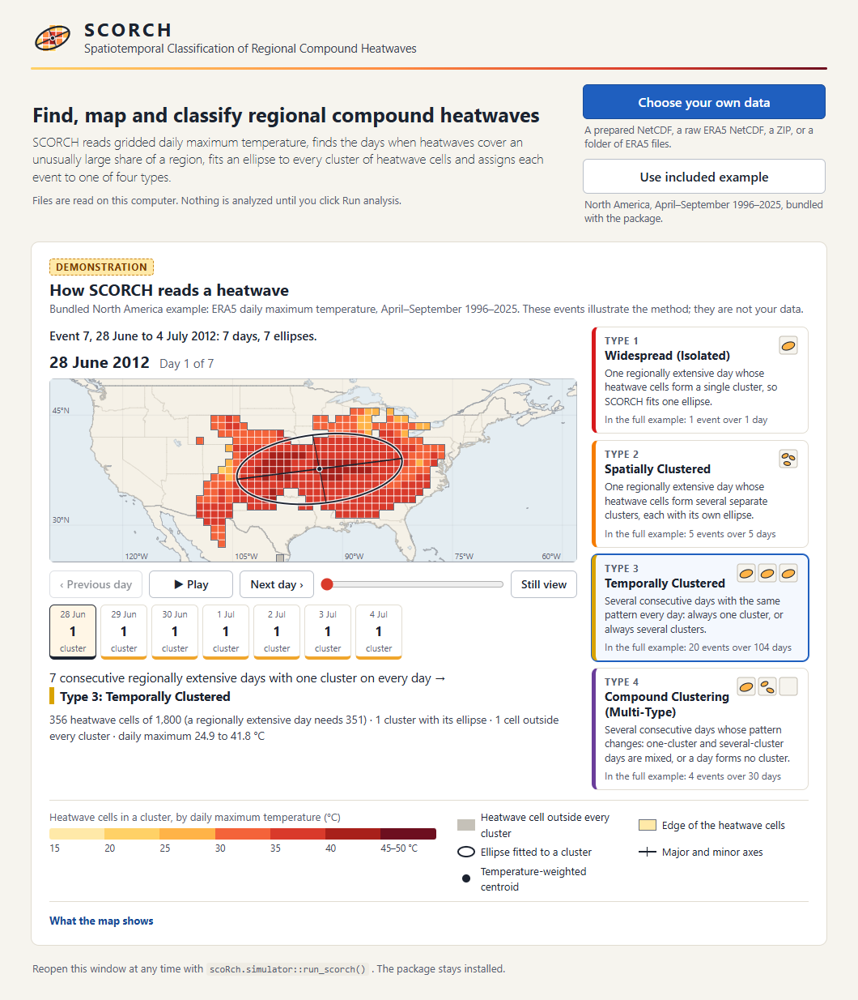

# scoRch.simulator

[](https://github.com/fawazbouhamad/scoRch.simulator/releases/tag/v1.0.0)
[](https://github.com/fawazbouhamad/scoRch.simulator/actions/workflows/checks.yaml)
[](LICENSE.txt)

**scoRch.simulator** is an R package for identifying and classifying regional compound heatwaves in gridded temperature data. It implements the **Spatiotemporal Classification of Regional Compound Heatwaves (SCORCH)** framework developed by Fawaz Bouhamad and Nasser Najibi.

## Install and open

Open RStudio with **R 4.4 or newer**. Paste both lines into the Console and press Enter. This installs the stable `v1.0.0` release and opens the dashboard.

```r
source("https://raw.githubusercontent.com/fawazbouhamad/scoRch.simulator/v1.0.0/software/setup/install.R")
install_scorch()
```

**To reopen the dashboard** in a later R session, run this line.

```r
scoRch.simulator::run_scorch()
```

<details>
<summary>Installing on Linux</summary>

Install R’s build tools, NetCDF and libuv before running the block. On Debian or Ubuntu, the packages are `r-base-dev`, `libnetcdf-dev` and `libuv1-dev`. On Fedora, the corresponding development libraries are `netcdf-devel` and `libuv-devel`.

</details>

## Run an analysis

1. Click **Use included example** to try the North America dataset, or **Select Your Data** to open a NetCDF file, a ZIP archive or a folder of ERA5 files. For a folder, open it and click **Use this folder**.
2. Review the detected dataset, choose the months to analyze in each year, and select a results folder. Under **Advanced settings**, you can adjust the detection, clustering and models.
3. Click **Run analysis**. When it finishes, select an event type and event to explore its daily maps. **Open summary** shows the main findings. **Open results folder** takes you to the saved files.



### Using your own data

Use daily maximum temperature on a regular longitude–latitude grid, or supply ERA5 2-m air temperature in kelvin or degrees Celsius. For hourly ERA5, SCORCH calculates the maximum at each grid point over each complete UTC day. It converts kelvin to °C and averages complete blocks of daily maxima to the selected grid size. Prepared daily data keep their existing grid.

You can select a ZIP directly or choose a folder containing NetCDF files (`.nc` or `.nc4`), including files organized one folder per year. The dashboard reads the coordinates, variable and units and asks for clarification when needed.

### Results and reproducibility

Each guided run creates a numbered folder containing `Summary.txt`, the effective `config.yaml`, five catalogs, heatwave statistics, model workbooks and figures. Each event has its own PNG, numbered chronologically across all four types. [Browse the example results](demo/output/)

To repeat a run from a script, pass its saved configuration to the same function. A scripted run writes to the output directory in that configuration.

```r
scoRch.simulator::run_scorch("path/to/config.yaml")
```

## North America example

The bundled example covers April–September 1996–2025 across the contiguous United States and surrounding areas. With the default settings, SCORCH identifies **30 events** across 1,800 grid cells.

| Type 1 · Widespread (Isolated) | Type 2 · Spatially Clustered | Type 3 · Temporally Clustered | Type 4 · Compound Clustering |
|---:|---:|---:|---:|
| 1 | 5 | 20 | 4 |

The example is ready to run after installation. Zenodo also provides the two input formats as separate downloads.

| Download | Size | Contents |
|---|---:|---|
| [Processed NetCDF](https://zenodo.org/records/24232552/files/SCORCH_NA_processed_1996_2025.nc?download=1) | 34 MB | Daily maximum temperatures included with the package |
| [Hourly ERA5 ZIP](https://zenodo.org/records/24232552/files/SCORCH_NA_unprocessed_1996_2025.zip?download=1) | 6.33 GB | 30 seasonal NetCDF files, one per year |

## Citation and license

Cite the package with `citation("scoRch.simulator")`. When using the example, also cite its dataset. [Software citation](CITATION.cff) · [Dataset DOI](https://doi.org/10.5281/zenodo.24232552) · [SCORCH study and workflow](https://github.com/fawazbouhamad/compound-heatwave-typologies-SCORCH)

The code is licensed under GPL-3.0-or-later. The workflow artwork and processed demonstration data are licensed under CC BY 4.0. The data contain modified Copernicus Climate Change Service information 2026. [Code license](LICENSE.txt) · [Data provenance and terms](demo/PROVENANCE.txt)

[Climate Resilience Lab, University of Florida](https://nassernajibi.github.io/lab/) · [Report an issue](https://github.com/fawazbouhamad/scoRch.simulator/issues)

---

<p align="center">
  <a href="https://nassernajibi.github.io/lab/"></a><a href="https://www.ufl.edu/"></a>
</p>
<p align="center">
  <a href="https://nassernajibi.github.io/lab/">Climate Resilience Lab</a><br>
  Department of Agricultural and Biological Engineering<br>
  University of Florida, Gainesville, Florida
</p>
