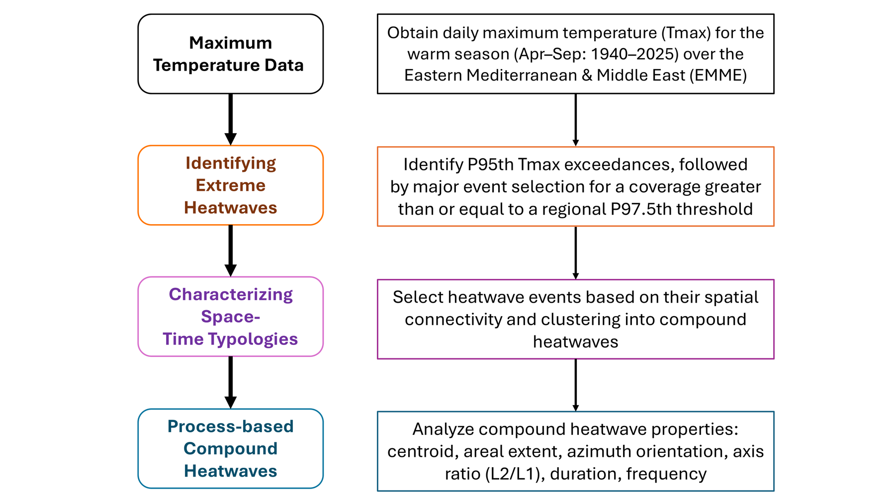

# scoRch.simulator

[](https://github.com/fawazbouhamad/scoRch.simulator/actions/workflows/R-CMD-check.yaml)
[](https://github.com/fawazbouhamad/scoRch.simulator/actions/workflows/demo.yaml)

**Find, classify and model regional compound heatwaves from gridded temperature data.**
scoRch.simulator implements SCORCH (Spatiotemporal Classification of Regional
Compound Heatwaves), developed by Fawaz Bouhamad and Nasser Najibi.

| Start here | Contents |
|---|---|
| [**Software**](src/) | The complete R package: analysis, preprocessing, models, figures, help and tests |
| [**Demo**](demo/) | Prepared and hourly input options, configurations, runners and example results |
| [**Docs**](docs/) | User guide, software structure, verification and supporting material |

<p align="center"></p>

The controller `run_scorch()` reads one YAML configuration and prepares the
temperature data. It connects five catalog stages: local heatwaves,
regionally extensive days, spatial clusters, fitted ellipses and compound
events. It then fits the power-law and log-Gaussian Cox process models and
writes the workbooks and figures. [How the software fits together](docs/structure.md)
shows where each part lives.

## Install

R 4.1 or newer is required. Run in R; dependencies install automatically:

```r
install.packages("remotes")
remotes::install_github("fawazbouhamad/scoRch.simulator", subdir = "src")
```

The package is pure R and supports Windows, macOS and Linux. The current
main branch is version 1.0.1; the historical `v1.0.0` release retains the
earlier name, scoRch.generator. See the [change log](src/NEWS.md).

## Choose a demonstration

Download or clone this repository, then run these commands from its top
folder after installing the package.

| Input | Run | What happens |
|---|---|---|
| **Prepared daily Tmax** | `Rscript demo/run_demo.R` | Uses the bundled 30-year regional data and runs the complete analysis |
| **Hourly ERA5** | `Rscript demo/run_hourly_demo.R path/to/hourly_folder` | Processes locally supplied hourly data, saves reusable daily Tmax, then runs the complete analysis |

Both configurations retain the study's analysis settings, including 5,000
power-law bootstrap repetitions and fixed seeds. The domain covers the
contiguous US and its surroundings (25–50°N, 130–58°W), every April–September
day of 1996–2025. The prepared demonstration has 1,800 one-degree cells and
5,490 dates; its input is about 12 MB.

**Hourly archive status:** the full 30-year source and its matching prepared
file are being acquired and validated for a separate data deposit. The
hourly runner is ready for local files; that archive has no new published
DOI yet. The current compact prepared file remains available and unchanged.
The [demo guide](demo/README.md) explains both routes, availability and the
precision difference between the historical baseline and the new pair.

## Find the results

Browse the [example results](demo/results/) directly:

| Results | Location |
|---|---|
| Catalogs 01–05: heatwaves, regional days, clusters, ellipses, compound events | [Heatwave_Catalogs](demo/results/Heatwave_Catalogs/) |
| Power-law fits and LGCP results | [Modelling](demo/results/Modelling/) |
| Event summaries, thresholds, daily extent and trends | [Additional_Results](demo/results/Additional_Results/) |
| Nine plots | [figures](demo/results/figures/) |

Each run writes eight Excel files (`.xlsx`), nine PNG figures and a
[`README.txt`](demo/results/README.txt) explaining every output. Your default
prepared run writes to `results/`; the hourly run writes to `results/hourly/`.
Existing workbook, sheet and figure names are preserved.

## Use your own data, read more, cite

```r
library(scoRch.simulator)
write_scorch_config("scorch_config.yaml")
# In that YAML, set input.file to your prepared NetCDF or local ERA5 files.
run_scorch("scorch_config.yaml")
```

Hourly processing computes each UTC day's maximum at the native grid points,
converts kelvin to Celsius, then averages complete blocks to one-degree
cells. Prepared daily Tmax enters the same catalog and modelling workflow.
The [user guide](docs/guide.md) and installed R help (`?run_scorch`) explain
the settings and input format.

[Verification](docs/verification/) documents agreement with the
[research reproducibility repository](https://github.com/fawazbouhamad/compound-heatwave-typologies-SCORCH).
Use [CITATION.cff](CITATION.cff) or `citation("scoRch.simulator")` to cite the
software. Code is [GPL-3.0-or-later](LICENSE.txt); data and artwork attribution
are recorded with the [bundled data](src/inst/extdata/README.md).
For support, open an [issue](https://github.com/fawazbouhamad/scoRch.simulator/issues).
