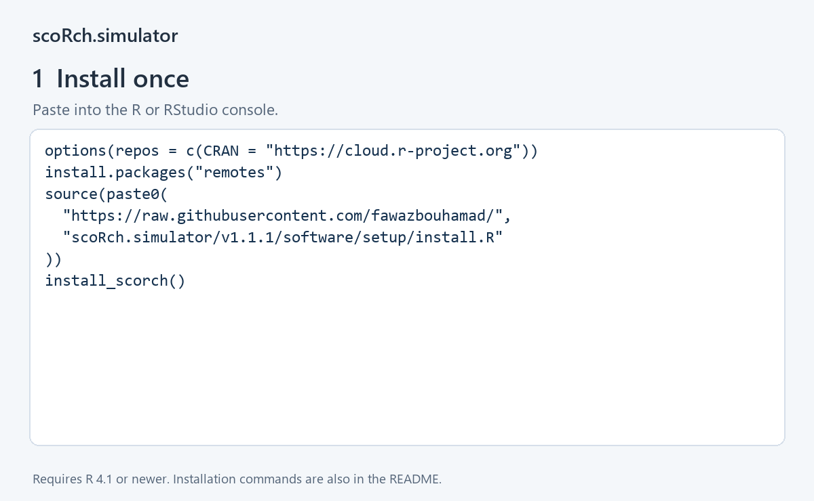
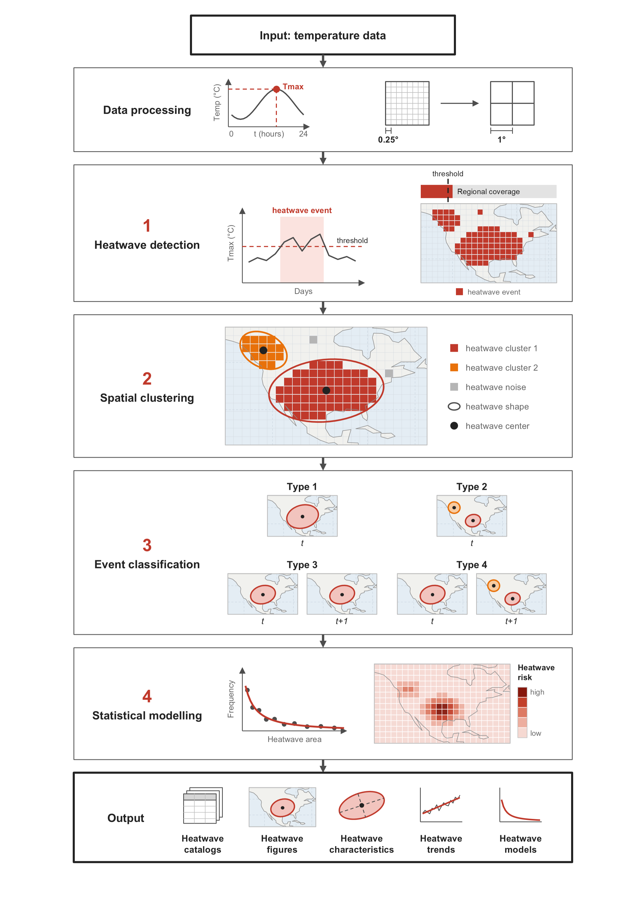
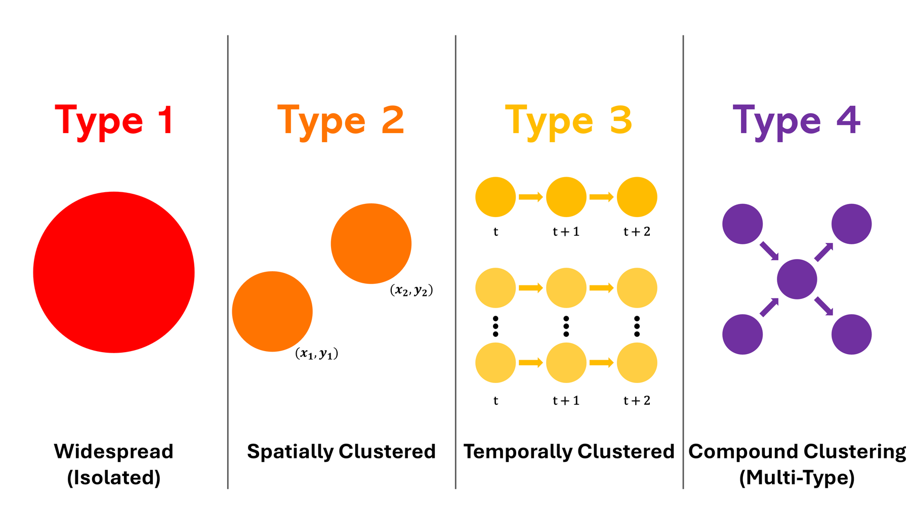

# User guide

Install or update the package using the [README instructions](../README.md#installation). Restart R before updating; your project configuration and data stay in place.

This guide covers `scoRch.simulator`. The historical `scoRch.generator` release uses different commands and folders.

## Use your own data

Open an RStudio project for your analysis, then create the configuration once:

```r
scoRch.simulator::write_scorch_config()
```

Open `config.yaml` in RStudio's Files pane. Set your data path and format under `input`, choose the results folder under `output`, and set the months and dates under `period`. See the [configuration example](#change-only-the-configuration) below. Save the file and run:

```r
scoRch.simulator::run_scorch()
```

The software processes your input and runs the entire analysis. For later runs, edit the same configuration and use the same command. You never need to run the numbered scripts individually.

## Try the bundled example

In a new RStudio project, run `scoRch.simulator::run_scorch()` without configuring an input. It creates `config.yaml` if absent and announces that it is using the bundled North America example. No data download is needed.



The supplied settings run the North America example: April–September 1996–2025, 1,800 one-degree cells and 5,490 dates in about 34 MB. The domain includes adjacent waters. Run time varies by computer. The analysis uses 5,000 bootstrap repetitions and fixed seeds.

## Open your results

R prints the completion status, any warnings and the full results-folder path. **Open `Summary.txt` first:** its status and warnings appear at the top, followed by the input, results, settings and files. Results go to `output/` inside your working folder unless configured otherwise; `getwd()` in R shows that folder.

| Supplied example result | Contents |
|---|---|
| [Summary](../demo/output/Summary.txt) | Counts, settings, files, warnings and a traced event |
| [Heatwave statistics](../demo/output/Heatwave_Statistics.xlsx) | Event-type summary, cell thresholds, daily extent and duration trends |
| [Catalogs 1–5](../demo/output/catalogs/) | Local heatwaves → regional days → clusters → ellipses → compound events |
| [Models](../demo/output/modeling/) | Power-law fits and the spatial model of ellipse centroids |
| [Figures](../demo/output/figures/) | 30 event images and 11 summary figures |

The `figures/` folder is organized as follows:

| Folder | PNG files |
|---|---|
| `events/Type_1/` through `events/Type_4/` | One `Event_001.png` per event, with all dated daily snapshots |
| `geometry/` | `Ellipses_by_type.png`, `Event_distributions.png` |
| `modeling/` | `Power_law.png`, `Spatial_model.png` |
| `temporal/` | `Annual_frequency.png`, `Annual_duration.png` |
| `spatial/` | `Centroids_and_axes.png`, `Ellipse_overlap.png`, `Axis_ratio.png`, `Area.png`, `Orientation.png` |

Event IDs follow the full chronological catalog and match `compound_event_id`
in Catalog 5; numbering does not restart for each type. Leading zeros keep
filenames in order: `Event_007.png` is Event 7. All four type folders exist;
a type with no events has an empty folder and a zero count in Summary.txt.
Every multi-day event has one image whose canvas grows to fit every day.
Figures use 600 dpi, or 500 dpi for `Ellipses_by_type.png`, with descriptive
headings and no paper panel letters.

To redraw one event from a saved result in R:

```r
scoRch.simulator::scorch_figure(result, "event", event_id = 7, file = "Event_007.png")
```

The combined spatial overview remains available with
`scorch_figure(result, "ellipse_spatial_patterns", file = "Overview.png")`.
The existing representative-event configuration applies only to manual legacy
comparison figures; automatic output always includes every event and every day.

Reruns replace package-generated files in the chosen output folder. Change `output: directory` to keep separate runs. Spreadsheet headers and identifying columns stay visible when scrolling wide catalogs, and long text wraps without changing stored values. Empty cells mean missing values. The summary identifies incomplete runs, unavailable models and skipped figures. The spatial model describes centroid occurrence intensity; exposure and vulnerability are not modeled, and concentration rank is not a heatwave probability.

## Change only the configuration

Open `config.yaml`, edit the settings you need, save it and run **the same command** again. Keep the indentation. Quote paths and use forward slashes, for example `"C:/data/temperature.nc"`. Relative paths use R's working folder.

Start with `input`, `output` and `period` at the top. The remaining sections mark optional scientific settings, advanced model settings and figure choices. All existing study defaults are retained unless you change them.

| Setting | What it controls |
|---|---|
| `input: file` | `null` runs the bundled example; otherwise enter your file or ERA5 folder |
| `input: format` | `daily_tmax` for prepared daily maxima; `era5` for local ERA5 temperature |
| `output: directory` | Destination for all results |
| `period` | Months and dates to analyze |
| Other sections | Heatwave thresholds, clustering, ellipses, models and figure choices |

For your own data, replace the matching sections with your paths and period:

```yaml
input:
  file: "C:/data/my_era5_folder"
  format: era5
  processed_file: "C:/data/prepared_tmax.nc"
output:
  directory: "output/my_analysis"
period:
  warm_season_months: [4, 5, 6, 7, 8, 9]
  start_date: "1996-04-01"
  end_date: "2025-09-30"
```

The software converts hourly temperature to UTC daily maxima, averages complete blocks into one-degree cells, saves prepared input when requested, and runs every analysis stage. Save prepared input outside the folder of ERA5 source files so later runs read only the source files. Obtain local NetCDF files for your chosen region first; no API key is used by the software. Hourly files need complete UTC days on the same regular grid without overlapping dates. Prepared input needs a complete record in every retained cell. `?read_era5` and `?read_tmax` explain the accepted formats.

Review the study defaults when changing region, season or period. Local thresholds use all analyzed dates; temperature-weighted centroids require positive Celsius Tmax in every cluster cell. Demonstration presets are kept inside the software and apply only to the bundled example or the explicit hourly demonstration. Your own input uses the settings in `config.yaml`. A different configuration can be passed to `run_scorch("C:/analysis/config.yaml")`.

## Download the demonstration data

The [North America dataset on Zenodo](https://doi.org/10.5281/zenodo.24232552) offers two independent downloads:

| File | Use |
|---|---|
| [SCORCH_NA_processed_1996_2025.nc](https://zenodo.org/records/24232552/files/SCORCH_NA_processed_1996_2025.nc?download=1) (33,841,054 bytes) | Ready to analyze; the same data are bundled with the software. For a downloaded copy, set `input: file` to its path and `input: format` to `daily_tmax`. |
| [SCORCH_NA_unprocessed_1996_2025.zip](https://zenodo.org/records/24232552/files/SCORCH_NA_unprocessed_1996_2025.zip?download=1) (6,333,591,973 bytes) | Extract once. Set `input: file` to the extracted `SCORCH_NA_unprocessed_1996_2025/` folder containing the 30 yearly NetCDF files, and `input: format` to `era5`. |

Both cover April–September 1996–2025. Processing takes the maximum of each native point's 24 hourly temperatures per UTC day, converts Kelvin to Celsius, then takes the equal-weight arithmetic mean of each complete 4×4 block of 0.25° points. Each point has weight 1/16; this temperature aggregation does not use latitude, area or temperature weights. Output is float64. Temperature weighting is used separately for ellipse centroids. See [provenance](../demo/PROVENANCE.txt) for checksums and attribution.

## Understand the workflow

Temperature → local heatwaves → regionally extensive days → spatial clusters → ellipses → compound events → models, tables and figures.



Local heatwaves belong to individual grid cells. Consecutive regionally extensive days form compound events, classified by their daily cluster counts:

| Type | Pattern |
|---|---|
| 1 | One day with one cluster |
| 2 | One day with several clusters |
| 3 | Several days, each with one cluster, or each with several clusters |
| 4 | Several days mixing those patterns, or including a day without a cluster |



The original study covers the Eastern Mediterranean and Middle East, 1940–2025. The bundled North America example applies the same method to another input. The [research reproduction](https://github.com/fawazbouhamad/compound-heatwave-typologies-SCORCH) and [study dataset](https://doi.org/10.5281/zenodo.21717874) are separate records.

## Repository guide

| Location | Purpose |
|---|---|
| [config.yaml](../config.yaml) | Your editable settings |
| [software/scripts/](../software/scripts/) | Numbered analysis modules |
| [software/help/](../software/help/) | R help pages; `.Rd` means R documentation |
| [software/figures/](../software/figures/) | Workflow, event types and demonstration |
| [software/setup/](../software/setup/) | Installation, package metadata and maintenance |
| [software/tests/](../software/tests/) | Automated checks; `testthat` is the library, fixtures are reference data |
| [demo/](../demo/) | Example input, saved results, attribution and optional launcher |

## Developer setup and verification

The installer maps `scripts/` to R's `R/`, `help/` to `man/`, and setup metadata to the package root. `DESCRIPTION` lists package information and dependencies; `NAMESPACE` lists exported functions. Fixture-local `.gitattributes` preserves CSV line endings.

To install a downloaded repository, source `software/setup/install.R` and call `install_scorch(path = ".")`. From the repository root, `Rscript demo/run.R` runs the same workflow; `Rscript software/setup/maintenance.R compare` checks it against `demo/output/`. Use `--help` for validation and rebuild commands. To restore the exact published demo input, run `Rscript software/setup/maintenance.R make-demo path/to/SCORCH_NA_processed_1996_2025.nc`; it verifies the published checksum before copying the file. Assemble with `Rscript software/setup/install.R .package`, then check with `devtools::check(".package")`.

The installer defaults to the stable `v1.1.0` tag. Developers can request `install_scorch(ref = "main")` or another Git ref. Reinstallation is enabled by default so a same-version development build can be replaced; dependency upgrades remain disabled unless requested.

[GitHub Actions](https://github.com/fawazbouhamad/scoRch.simulator/actions) checks Windows, macOS and Linux and compares the demonstration. The reference has 65,409 local heatwaves, 140 selected days, 379 ellipses and 30 compound events (Types 1–4: 1, 5, 20 and 4). All 16 worksheets are compared at portable tolerances of 1e-6, or 1e-3 for LGCP fits. Optional full-study tests require the separate reference input. The bundled input is byte-for-byte identical to the published float64 NetCDF, without additional rounding or integer packing. Full 30-year validation of the accompanying hourly archive and processed input gave identical scientific results and all 16 worksheets.

The authors developed the method and study implementation. Claude Code and Codex assisted with packaging, documentation, input interfaces, figure alignment and validation. The authors retain responsibility for the software and manuscript.

For citation, licence and contact information, see the [README](../README.md#how-to-cite).
